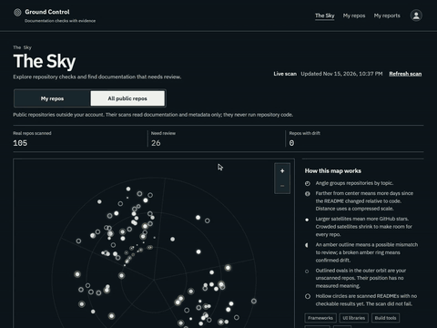
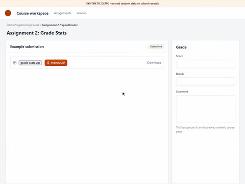
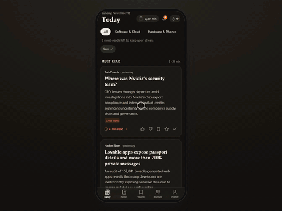
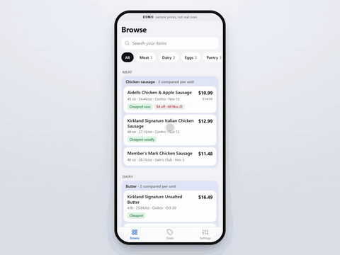
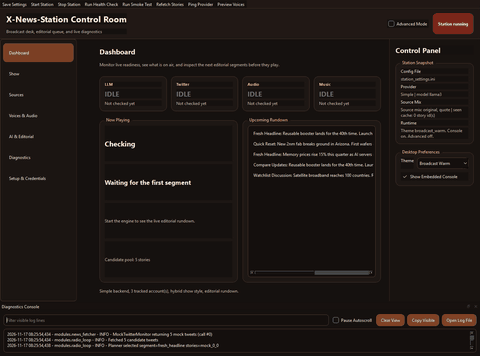
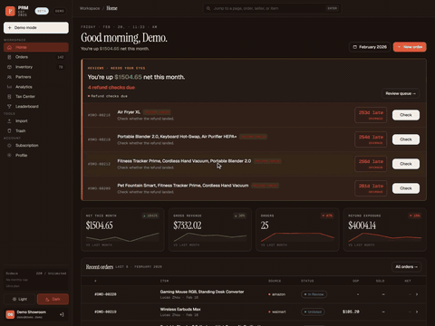

## Hi, I'm Hussein

Full-stack and AI integration engineer in St. Louis. I build web apps with React, Angular, .NET and Node, run them on Azure, and add AI features with Azure OpenAI. Microsoft certified (AZ-204, AI Apps & Agents).

### Selected work

<table>
<tr>
<td width="50%" valign="top">

<h4>Ground Control 🏆</h4>
1st place, HackWashU 2026 Fall AI Build Challenge. Checks whether a repo's README still matches its code and maps the results for public repos as a live sky. 
TypeScript · Bun · Gemini · GitHub Actions · Docker 
<a href="https://devpost.com/software/ground-control-qdsam7">Devpost</a> · <a href="https://github.com/rcwoshimao/hackwashu-2026">Code</a>
</td>
<td width="50%" valign="top">

<h4>Canvas ZIP Preview</h4>
Chrome extension that opens ZIP submissions right inside Canvas SpeedGrader, so graders stop downloading and unzipping each one. 
JavaScript · Chrome Extension (Manifest V3) 
<a href="https://chromewebstore.google.com/detail/canvas-zip-preview/akllkgknphifpchfaofhkancpdplocpg">Chrome Web Store</a> · <a href="https://github.com/huss2342/canvas-zip-preview">Code</a>
</td>
</tr>
<tr>
<td width="50%" valign="top">

<h4>Daily Digest</h4>
A 30-minute morning news briefing: 3 to 5 must-reads, summaries of the rest, and picks that adjust to your 👍 and 👎. Installs to a phone's home screen. 
TypeScript · Azure Static Web Apps · Azure Functions · Azure OpenAI 
private repo
</td>
<td width="50%" valign="top">

<h4>Price Log</h4>
Photograph a price tag and get the item, price, size and unit price back, with store markdown codes decoded. Works offline and syncs later. 
Angular PWA · Spring Boot (Java 21) · Azure OpenAI vision 
<a href="https://salmon-sand-05b9e270f.7.azurestaticapps.net">Demo</a> · <a href="https://github.com/huss2342/price-log">Code</a>
</td>
</tr>
<tr>
<td width="50%" valign="top">

<h4>X-News-Station</h4>
Turns the X accounts you follow into a live radio news show, with an anchor and analyst voice, segment planning and recaps. Runs fully local. 
Python · PySide6 · Ollama · Kokoro TTS 
<a href="https://github.com/huss2342/x_news_station">Code</a>
</td>
<td width="50%" valign="top">

<h4>prmtool</h4>
Order and inventory SaaS for resale businesses: orders, inventory, partner settlements, a tax center, and AI spreadsheet import that shows a diff before anything is saved. 
React · Node.js · PostgreSQL · Azure · Stripe · Azure OpenAI 
<a href="https://prmtool.app">Live demo</a> · private repo
</td>
</tr>
</table>

### Also built

- DocMorph (private): turns invoices, receipts and bank statements into validated CSV and JSON with Azure OpenAI
- [TerrainCraft](https://github.com/huss2342/cudaTerrain): GPU procedural terrain generation in CUDA C++, about 300x faster than the same code on one CPU core
- [RichArduino GUI](https://github.com/huss2342/Oscilloscope_Host) and [VHDL design](https://github.com/huss2342/Oscilloscope_VHDL): an oscilloscope on a custom PCB, from FPGA to Qt desktop app
- [shadPS4](https://github.com/shadps4-emu/shadPS4/pull/693): added the Arabic translation to the PS4 emulator (merged)

### Tools

